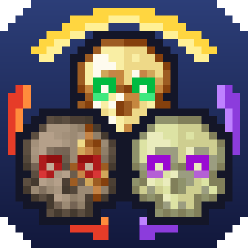
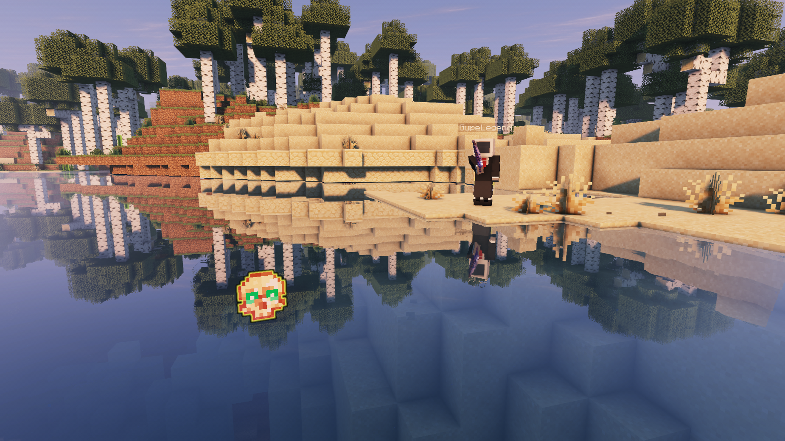
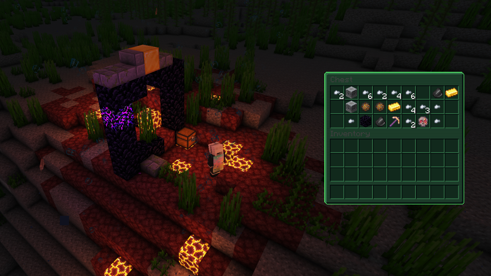
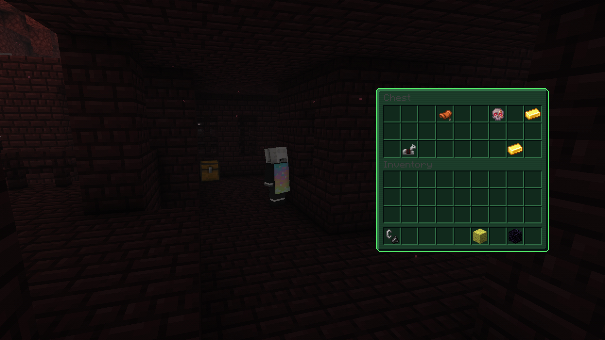
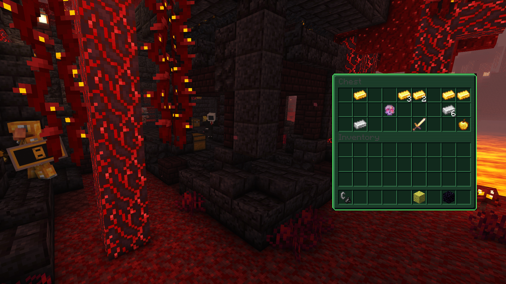
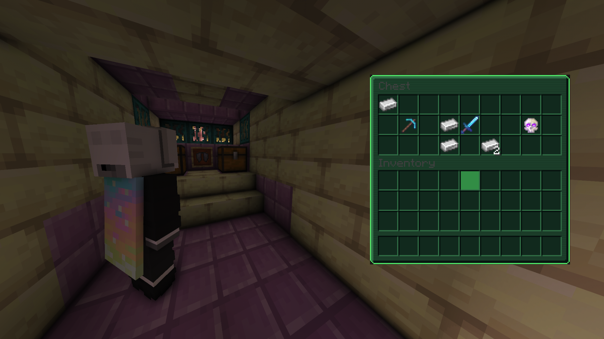

<p align="center"></p>

# UltraRevive

[](https://papermc.io)
[](https://papermc.io)
[](https://adoptium.net)
[](LICENSE)

A Paper plugin by **Social Studio**.

**Don't die on the first hit.** When a blow would kill you, you go down instead: prone, glowing,
unable to fight. Your team has a few seconds to reach you and pick you back up. If nobody comes, you
bleed out.

UltraRevive turns every fight into a team fight. Rushing in alone is a risk, staying close to your
friends pays off, and a rescue under fire is one of the best moments you'll have on your server.

```
[UltraRevive] ☠ Steve was downed. A teammate can revive them!
[UltraRevive] ✔ Steve was revived.
```

---

## Screenshots

<p align="center">
  
  
</p>
<p align="center">
  
  
</p>
<p align="center">
  
</p>

## ☠ Going down

When a hit would kill you, you drop to the floor instead of dying.

- You **crawl**, **glow red** and can't attack, break or place blocks, drop items or eat.
- You're slowed and partly blinded, and a **boss bar counts down** your last seconds (60 by
  default).
- **Mobs and the environment can't finish you off.** Another player can.
- The void still kills, so nobody is left falling forever.
- **Logging out while down kills you.** Combat-logging doesn't save anyone.

The last seconds are tense on purpose. A **heartbeat** speeds up as time runs out, blood particles
start to fall, and a **beam of light** over your body shows your team where you are.

Two buttons appear in chat:

- **[Surrender]**: give up and die right away.
- **[Self-revive]**: only if you carry a totem that allows it.

## ✚ Reviving

**Crouch next to a downed player for 5 seconds** and they're back on their feet.

- **It costs hunger.** If you're starving, you can't do it, so bring food.
- **Co-op reviving**: more people crouching at once go faster.
- **Progress isn't lost at once.** If you step away, it freezes for a moment and then drains
  slowly, so you can dodge an arrow and come back.
- Optional rules for harder servers:
  - getting hit while reviving interrupts you;
  - **fatigue**: going down again and again in a short time shortens how long you last.

Nearby players are told who went down, who got back up and who bled out, each with its own sound.

## ✦ The three totems

Three real items, each with its own texture. They **don't** stop you from going down; they change
what happens after. That's what makes the self-revive button worth something.

### Blessed Totem of the Aether
*Golden, with green eyes.*
Use it while downed (button or right-click) and you stand up on your own, with Absorption,
Regeneration and a moment of dizziness.
**Found in:** buried treasure chests (**20%**) and fishing (**0.5%**).

### Cursed Totem of the Nether
*Worn stone, with red eyes.*
While it's in your inventory you revive others **3× faster**, and they come back at **full health**
with Regeneration and Absorption. It costs you **20 seconds of Wither**. And if you die while
carrying it, there's no going down: **you die outright**.
**Found in:** ruined portals (**0.67%**), bastions and Nether fortresses (**1.2%**).

### Unknown Totem of the End
*Pale bone, with purple eyes.*
Use it while downed and you get up **and get sent to your bed**, blinded for two minutes. Use it
while reviving someone else and it leaves a **healing area** behind for your team.
**Found in:** End ship chests (**0.00067%**). Yes, it's meant to be a legend.

Every chance can be changed in the config, per structure. The plugin marks its totems with a hidden
tag, so a renamed vanilla totem can't be used as one of them.

## 🎨 The resource pack

The totem textures come in a small resource pack, and **the plugin serves it by itself**: players
are offered it when they join, so you don't have to host anything.

- It **only changes the three UltraRevive totems** (custom model data `130001`, `130003` and
  `130007`). A normal Totem of Undying keeps its vanilla look, and no other item, block or menu is
  touched.
- Without the pack everything still works; the totems just look like normal totems.

```yaml
resource-pack:
  enabled: true
  mode: internal     # internal = the plugin serves it · url = you host it
  port: 8081         # open this port on your host
  url: ""            # only for mode: url
  force: false       # true = players must accept it
```

**Already sending your own pack?** Add the UltraRevive pack to it (or import the ZIP into your pack
manager and rebuild), then set `resource-pack.enabled: false`. If your pack also changes the Totem
of Undying, merge that one file by hand: keep the three entries above and leave your model as the
fallback.

## 📊 Stats

`/ur stats` shows how many times you went down, how many times you were revived, how many teammates
you saved, how many times you got up on your own, and how many times you bled out.

---

## Commands

| Command | What it does |
|---|---|
| `/ur` | Help |
| `/ur surrender` | Give up while downed |
| `/ur selfrevive` | Use a totem to get up |
| `/ur stats [player]` | Rescue statistics |
| `/ur reload` | Reload config and language (admin) |
| `/ur revive <player>` | Revive a downed player (admin) |
| `/ur down <player>` | Down a player (admin) |
| `/ur finish <player>` | Finish off a downed player (admin) |
| `/ur give <self\|boost\|end> [player] [amount]` | Give a totem (admin) |

## Permissions

| Permission | Default | |
|---|---|---|
| `ultrarevive.admin` | op | Admin commands |
| `ultrarevive.bypass` | false | That player never goes down |
| `ultrarevive.revive` | everyone | Can revive others |
| `ultrarevive.surrender` | everyone | Can surrender |

## Configuration

Everything lives in one commented `config.yml`. A few examples:

```yaml
down-duration: 60        # seconds you last while downed
revive-duration: 5       # seconds it takes to revive
revive-radius: 3.0
hunger-cost: 6           # hunger it costs the reviver

coop-revive:
  enabled: true          # more revivers = faster

downed-fatigue:
  enabled: false         # going down again and again shortens your time

enabled-worlds: []       # empty = every world
```

The config also covers:
- health and effects;
- glow and boss bar colours;
- what a downed player can and can't do;
- the beacon and the heartbeat;
- every sound and every drop chance.

**English and Spanish** are included. Changing `language:` translates the chat **and** the totem
names and descriptions.

## Requirements

- **Paper 26.1.2** or newer (Spigot isn't supported)
- **Java 25**
- No dependencies. **LuckPerms** is optional.

## Install

Drop the jar in `plugins/` and start the server. Everything is configured and working out of the
box.

Data lives in **`plugins/UltraRevive/`**. Older installs that still have data in the previous shared
folder (`plugins/UltraView/UltraRevive/`) get it moved over automatically on startup. Your config
is never overwritten on update.

---

## Building

With Gradle (recommended):

```bash
./gradlew build           # -> build/libs/UltraRevive-1.0.jar
```

Or without Gradle, just `javac`:

```bash
bash compilar.sh          # -> build/UltraRevive-1.0.jar
```

`compilar.sh` downloads its dependencies to a local `libs/` folder on first run. Either way you
need **JDK 25**: Paper 26 is compiled for Java 25, and with an older JDK the compiler fails with a
`cannot access Player` error that looks like an API problem but isn't.

## Project layout

```
src/main/java/mc/gupe/revive/
  UltraRevive.java         startup, listener and command registration
  api/                     public API and events
  command/                 /ur
  config/                  config.yml and lang/*.yml loading
  integration/             optional LuckPerms bridge
  item/                    builds and recognises the three totems
  listener/                combat, connection, loot, restrictions, stats
  migration/               moving data from older install layouts
  model/                   downed-player state, cooldowns
  pack/                    the resource pack's HTTP server
  revive/                  the core: going down, the countdown, reviving, bleeding out
  stats/                   per-player statistics
  util/                    player-head skins for menus

src/main/resources/
  config.yml               every timer, health value, effect and drop chance
  lang/{en,es}.yml          all player-facing text, including item names and lore
  resourcepack.zip          the totem textures, served by the plugin
```

## Internationalisation

Two languages: **English** (default) and **Spanish**. `language:` in `config.yml` switches
*everything* — chat messages **and** the totem names and lore.

Item names live in `lang/<lang>.yml`, not in `config.yml`, on purpose: if they lived in the config,
changing the language would translate the messages but leave the items in whatever language the
file was first generated with.

## Public API

Other plugins can ask whether a player is down, without a compile-time dependency:

```java
UltraReviveAPI.isDowned(uuid);
UltraReviveAPI.isReviving(uuid);
```

Plus the Bukkit events `PlayerDownedEvent` and `PlayerRevivedEvent`.

## Notes for contributors

Three things in here are load-bearing and easy to break:

**Never kill inside a damage event.** When a downed player takes the finishing blow, the kill is
deferred one tick. Killing inline nests a death inside the damage pipeline and the server processes
two deaths for one hit — the inventory empties on the first and the second takes the loot with it.
This bit us in production.

**Never `setOwningPlayer(OfflinePlayer)` in a menu.** If that player's profile isn't cached, Paper
goes and asks Mojang for the textures **from the main thread**. Use the `util.PlayerHeads` cache
instead.

**The hidden tag on an item carries the plugin name.** `new NamespacedKey(plugin, "ur_item")`
stores it as `ultrarevive:ur_item`. Rename the plugin and every totem already handed out stops
being recognised — they become plain totems of undying. That's what `item.LegacyKeys` is for;
don't delete it.

Code comments are in English; `config.yml` stays in Spanish, like the rest of its options.

## License

MIT — see [LICENSE](LICENSE). Use it, change it, ship it; just keep the copyright notice.
